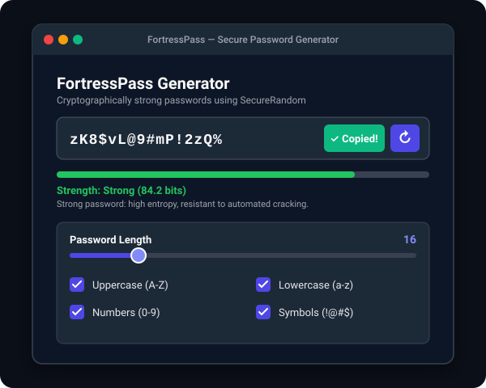
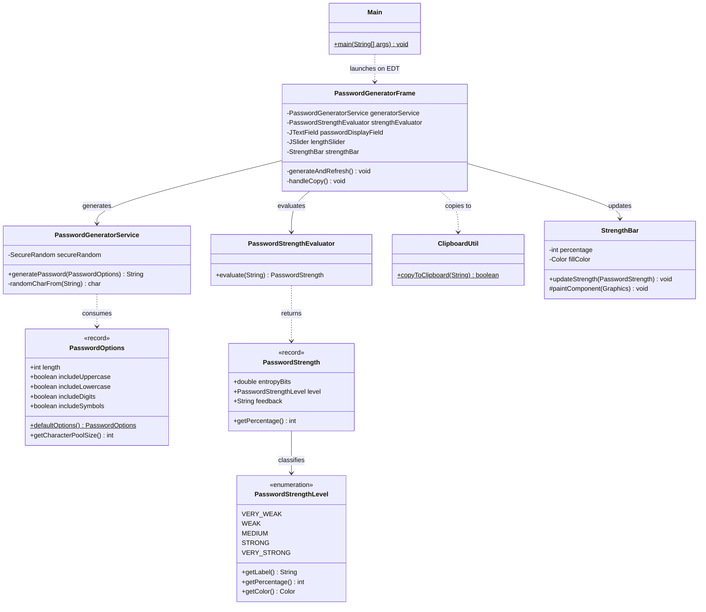

# 01 - Password Generator (FortressPass)

A high-entropy, cryptographically secure desktop password generator engineered in Java Swing featuring real-time Shannon entropy strength metrics, customizable character pools, and one-click clipboard export.

---

## 📸 Screenshots



---

## 🚀 Features
- **Cryptographically Secure PRNG**: Powered by `java.security.SecureRandom` utilizing operating system entropy rather than predictable linear congruential algorithms.
- **Strict Inclusion Guarantees**: Guarantees that at least one character from each selected category is included, followed by a cryptographic Fisher-Yates shuffle.
- **Shannon Entropy Strength Bar**: Real-time evaluation of password entropy (in bits) factoring in pool size, repetition penalties, and security tiers.
- **Dynamic Live Feedback**: Sliders and checkboxes trigger instant regeneration and entropy recalculation without manual submit buttons.
- **System Clipboard Integration**: One-click copy with dynamic visual feedback ("✓ Copied!") and safety fallbacks for headless environments.
- **Modern Dark-Themed GUI**: Polished dark interface adhering to modern UI/UX principles.

---

## 🛠️ Tech Stack
- **Language**: Java 17 (LTS)
- **GUI Framework**: Java Swing (`JFrame`, `JSlider`, `JCheckBox`, custom `Graphics2D` rendering)
- **Cryptography & Math**: `java.security.SecureRandom`, Shannon Information Entropy formula
- **Testing**: JUnit 5, AssertJ
- **Build Tool**: Apache Maven

---

## 📋 Copy-Paste Run Commands

### 1. Run Directly with Maven
```bash
cd 01-password-generator
mvn clean compile exec:java
```

### 2. Run All Tests
```bash
mvn test
```

### 3. Package & Run as Standalone JAR
```bash
mvn clean package
java -jar target/01-password-generator-1.0.0.jar
```

---

## 📂 Project Structure

```
01-password-generator/
├── pom.xml
├── README.md
└── src/
    ├── main/
    │   └── java/
    │       └── com/portfolio/passwordgen/
    │           ├── Main.java                          # EDT entry point
    │           ├── model/
    │           │   ├── PasswordOptions.java           # Record with validation & pool math
    │           │   ├── PasswordStrength.java          # Result record (bits, level, feedback)
    │           │   └── PasswordStrengthLevel.java     # Enum with colors & thresholds
    │           ├── service/
    │           │   ├── PasswordGeneratorService.java  # CSPRNG generator with shuffle
    │           │   └── PasswordStrengthEvaluator.java # Shannon entropy calculator
    │           ├── ui/
    │           │   ├── PasswordGeneratorFrame.java    # Swing GUI layout & listeners
    │           │   └── StrengthBar.java               # Custom rounded painted meter
    │           └── util/
    │               └── ClipboardUtil.java             # System clipboard adapter
    └── test/
        └── java/
            └── com/portfolio/passwordgen/
                ├── model/
                │   └── PasswordOptionsTest.java       # Validation & pool tests
                └── service/
                    ├── PasswordGeneratorServiceTest.java # 6 comprehensive tests
                    └── PasswordStrengthEvaluatorTest.java # 4 entropy tests
```

---

## 📊 Class Architecture Diagram



---

## 🔮 Future Improvements
- **Passphrase Mode**: Generate memorable diceware passphrases (e.g. `correct-horse-battery-staple`).
- **Export Formats**: Export batch generated passwords directly to encrypted CSV or KeePass compatible format.
- **Custom Character Set**: Allow users to define custom character exclusion sets (e.g. eliminate ambiguous characters like `0`, `O`, `l`, `1`).
