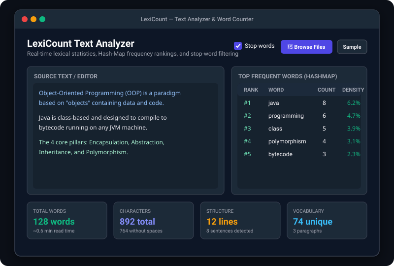
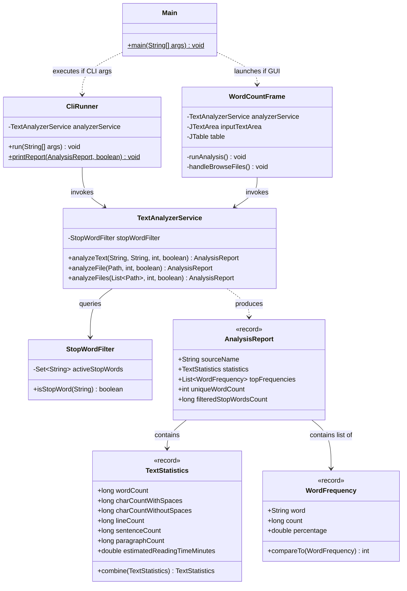

# 02 - Word Count & Text Analyzer (LexiCount)

A dual-mode (CLI & Swing GUI) lexical analysis tool capable of calculating total words, characters, sentences, lines, reading time estimates, multi-file batch aggregation, and Top-N keyword frequency rankings powered by `HashMap` and stop-word filtering.

---

## 📸 Screenshots



---

## 🚀 Features
- **Comprehensive Lexical Metrics**: Real-time evaluation of word counts, characters (with and without spaces), line counts, sentence detection (handling `.`, `!`, `?`), paragraphs, and estimated reading time at 200 wpm.
- **Top-N Keyword Frequency Ranking**: $O(N)$ frequency map collection utilizing `HashMap<String, Long>` combined with Java Streams ranking.
- **Smart English Stop-Word Filtering**: Eliminates high-frequency noise words (articles, prepositions, pronouns) to reveal true semantic keywords.
- **Multi-File Batch Aggregation**: Ingest and combine multiple text files simultaneously using modern Java NIO (`java.nio.file.Files`), producing aggregated reports with source breakdown.
- **Dual Presentation Interfaces**:
  - **Interactive Swing GUI**: Split-pane layout with live typing detection via `DocumentListener`, metric summary cards, and sortable `JTable`.
  - **Command-Line Interface (CLI)**: Formatted ASCII tabular reporting with command-line flags (`--file`, `--top`, `--no-stop-words`) or Unix pipe/stdin support.

---

## 🛠️ Tech Stack
- **Language**: Java 17 (LTS)
- **GUI Framework**: Java Swing (`JFrame`, `JSplitPane`, `JTable`, `DocumentListener`)
- **Data Structures**: `HashMap`, `HashSet`, `Record`, `Comparable`
- **I/O & Concurrency**: Java NIO (`Files.readString`, `Path`), RegEx (`Pattern`, `Matcher`)
- **Testing**: JUnit 5, AssertJ
- **Build Tool**: Apache Maven

---

## 📋 Copy-Paste Run Commands

### 1. Launch GUI Mode
```bash
cd 02-word-count-tool
mvn clean compile exec:java
```

### 2. Run CLI Mode on a Specific File
```bash
cd 02-word-count-tool
mvn exec:java -Dexec.args="--file src/main/java/com/portfolio/wordcount/service/TextAnalyzerService.java --top 10"
```

### 3. Run All Unit Tests
```bash
mvn test
```

### 4. Package & Run as Standalone JAR
```bash
mvn clean package
# CLI mode
java -jar target/02-word-count-tool-1.0.0.jar --file README.md --top 5

# GUI mode
java -jar target/02-word-count-tool-1.0.0.jar --gui
```

---

## 📂 Project Structure

```
02-word-count-tool/
├── pom.xml
├── README.md
└── src/
    ├── main/
    │   └── java/
    │       └── com/portfolio/wordcount/
    │           ├── Main.java                          # CLI/GUI router & EDT launcher
    │           ├── cli/
    │           │   └── CliRunner.java                 # CLI argument parser & ASCII renderer
    │           ├── model/
    │           │   ├── AnalysisReport.java            # Immutable analysis container record
    │           │   ├── TextStatistics.java            # Metrics record with combine() logic
    │           │   └── WordFrequency.java             # Frequency record with Comparable sort
    │           ├── service/
    │           │   ├── StopWordFilter.java            # O(1) stop-word lookup set
    │           │   └── TextAnalyzerService.java       # Lexical parser & frequency engine
    │           └── ui/
    │               └── WordCountFrame.java            # Modern dark GUI dashboard
    └── test/
        └── java/
            └── com/portfolio/wordcount/
                └── service/
                    ├── StopWordFilterTest.java        # 2 tests for casing & custom sets
                    └── TextAnalyzerServiceTest.java   # 7 tests for words, regex, batch files
```

---

## 📊 Class Architecture Diagram



---

## 🔮 Future Improvements
- **Multi-lingual Stop Words**: Support multilingual dictionaries (French, German, Spanish).
- **Exporting Options**: Export reports directly to CSV, JSON, or PDF formats.
- **TF-IDF Keyword Weighting**: Incorporate Term Frequency - Inverse Document Frequency (TF-IDF) scoring when analyzing collections of documents.
