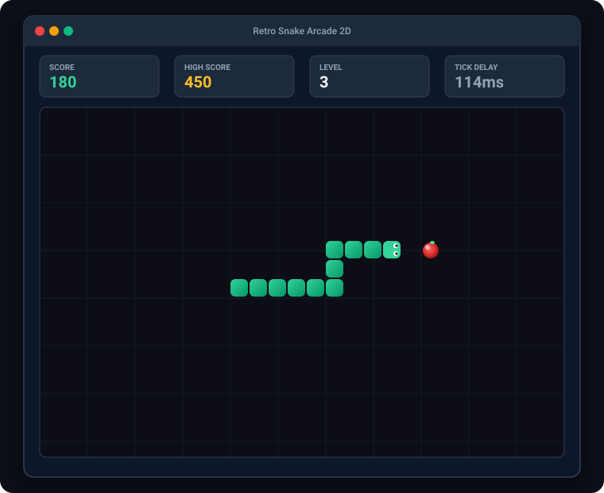
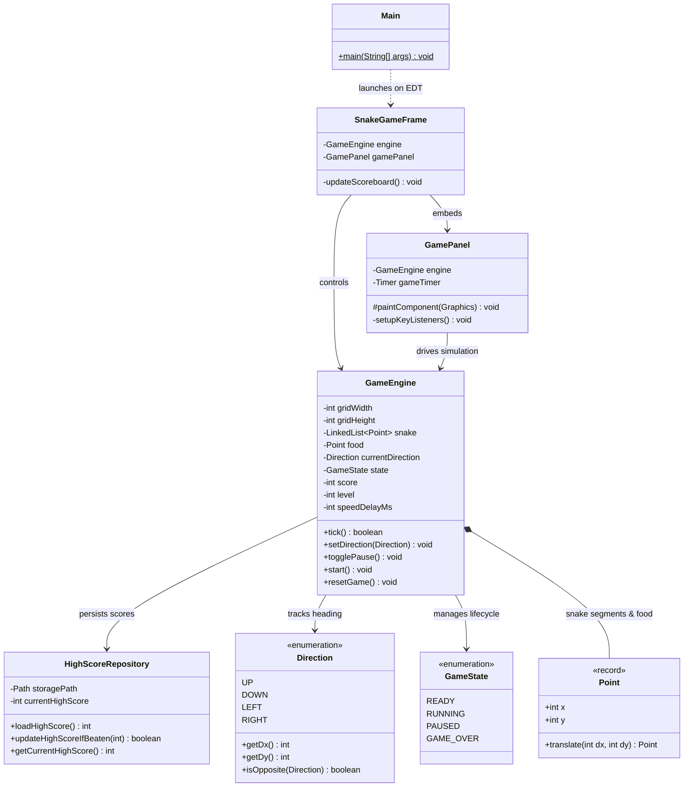

# 03 - Snake Game Arcade 2D

A high-performance 2D arcade Snake game engineered in Java Swing featuring a decoupled simulation engine, dynamic `Timer` game loop, progressive speed scaling, collision physics, and local high score file persistence.

---

## 📸 Screenshots



---

## 🚀 Features
- **Decoupled Simulation Engine**: Game physics, grid logic, and collision rules reside in an isolated `GameEngine` class completely free of UI dependencies, making 100% of game mechanics unit-testable via JUnit.
- **Real-Time Game Loop**: Powered by `javax.swing.Timer` executing on the Swing Event Dispatch Thread (EDT) for fluid 60fps-like graphics without multi-threading race conditions.
- **Progressive Difficulty & Speed Ramping**: Every 5 food items consumed raises the level, increases the score multiplier, and ramps velocity by reducing timer tick delays down to 45ms.
- **Strict Collision Mechanics**:
  - Wall collision detection against grid bounds `[0, gridWidth)` and `[0, gridHeight)`.
  - Self-collision detection preventing head intersection with any tail segment.
  - Direction buffer preventing illegal 180-degree instant reversal into itself.
- **Local High Score Persistence**: Historical records are persisted to disk via `HighScoreRepository` using Java NIO buffered streams with defensive error recovery.
- **Modern Arcade Aesthetics**: Vector-rendered custom `Graphics2D` canvas with grid lighting, glowing snake segments, animated eyes, and interactive HUD overlays (`READY`, `PAUSED`, `GAME_OVER`).

---

## 🛠️ Tech Stack
- **Language**: Java 17 (LTS)
- **GUI Framework**: Java Swing & AWT (`JFrame`, `JPanel`, `Graphics2D`, `javax.swing.Timer`)
- **Persistence**: Java File I/O (`BufferedReader`, `BufferedWriter`, `Path`)
- **Testing**: JUnit 5, AssertJ
- **Build Tool**: Apache Maven

---

## 📋 Copy-Paste Run Commands

### 1. Run Game Directly with Maven
```bash
cd 03-snake-game
mvn clean compile exec:java
```

### 2. Run All Unit Tests
```bash
mvn test
```

### 3. Package & Run as Standalone JAR
```bash
mvn clean package
java -jar target/03-snake-game-1.0.0.jar
```

### 🎮 Controls
- **Arrow Keys** or **W, A, S, D**: Steer Snake (Up, Down, Left, Right)
- **Spacebar**: Start Game / Pause / Resume
- **Enter** or **R**: Restart Game after Game Over

---

## 📂 Project Structure

```
03-snake-game/
├── pom.xml
├── README.md
└── src/
    ├── main/
    │   └── java/
    │       └── com/portfolio/snake/
    │           ├── Main.java                          # EDT entry point
    │           ├── model/
    │           │   ├── Direction.java                 # Velocity vectors & opposite guard
    │           │   ├── GameState.java                 # READY, RUNNING, PAUSED, GAME_OVER
    │           │   └── Point.java                     # Immutable 2D grid coordinates record
    │           ├── repository/
    │           │   └── HighScoreRepository.java       # Local file persistence for top score
    │           ├── service/
    │           │   └── GameEngine.java                # Headless game physics & rules engine
    │           └── ui/
    │               ├── GamePanel.java                 # 2D Graphics2D canvas & Timer loop
    │               └── SnakeGameFrame.java            # Top-level window with scoreboard
    └── test/
        └── java/
            └── com/portfolio/snake/
                ├── repository/
                │   └── HighScoreRepositoryTest.java   # File save/load & corruption tests
                └── service/
                    └── GameEngineTest.java            # Movement, collisions, speed tests
```

---

## 📊 Class Architecture Diagram



---

## 🔮 Future Improvements
- **Obstacle Modes**: Introduce static and moving maze walls for heightened tactical gameplay.
- **Power-Ups**: Spawn timed gold bonus apples (speed freeze, double points, ghost mode).
- **Sound FX**: Integrate audio clips for eating, level-ups, and game-over collision via Java Sound API (`javax.sound.sampled`).
