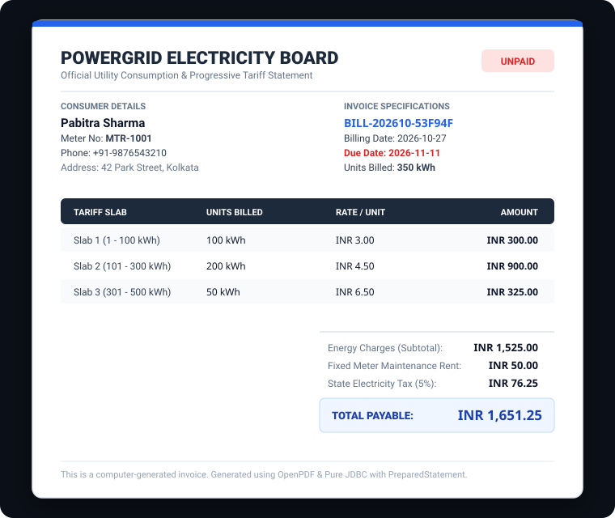
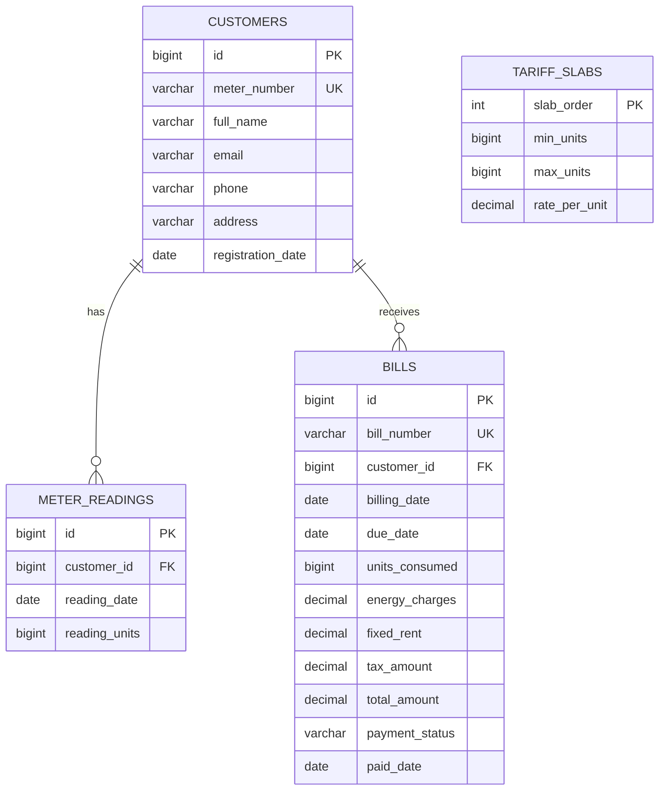

# 04 - Electricity Billing System (PowerGrid)

An enterprise utility management and billing system engineered with pure JDBC, parameterized `PreparedStatement` query security, zero-setup embedded H2 database (with optional MySQL profile), progressive tiered tariff calculation algorithms, and OpenPDF invoice generation.

---

## 📸 Screenshots



---

## 🚀 Features
- **Zero-Setup Embedded Database**: Boots immediately out-of-the-box using an embedded/in-memory H2 database engine without requiring local database installations or credentials.
- **Enterprise PreparedStatement Security**: Zero dynamic SQL string concatenations. All database queries utilize parameterized `PreparedStatement` to ensure complete immunity against SQL injection vulnerabilities.
- **Progressive Slab-Based Tariff Engine**: Slices electrical energy consumption across tiered consumption brackets (e.g. 1-100 kWh @ ₹3, 101-300 kWh @ ₹4.50, 301-500 kWh @ ₹6.50, 501+ kWh @ ₹8) with state tax and fixed meter maintenance rent.
- **Customer & Meter Reading Tracking**: Validates monotonic reading increments (rejecting invalid readings lower than the previous cycle) and computes cycle consumption deltas.
- **Dual Invoice Formats**:
  - **ASCII Monospace Terminal Bill**: Clean, printable terminal receipts.
  - **OpenPDF Statement Export**: Generates professional PDF invoices formatted with customer details, itemized slab breakdowns, tax calculations, and payment stamps.
- **Production MySQL Profile**: Includes root `docker-compose.yml` and `.env.example` to switch from H2 to MySQL 8.4 with a single flag.

---

## 🛠️ Tech Stack
- **Language**: Java 17 (LTS)
- **Data Access**: Pure JDBC (`Connection`, `PreparedStatement`, `ResultSet`, `Statement.RETURN_GENERATED_KEYS`)
- **Databases**: H2 In-Memory (default), MySQL 8.4 (optional containerized profile)
- **Document Generation**: OpenPDF (LibrePDF 1.3.43)
- **Testing**: JUnit 5, AssertJ
- **Build Tool**: Apache Maven

---

## 📋 Copy-Paste Run Commands

### 1. Run Automated Live Demo (Zero Setup)
Registers a customer, logs readings, computes slabs, displays the invoice, and exports a PDF to `target/sample_bill.pdf`:
```bash
cd 04-electricity-bill-system
mvn clean compile exec:java -Dexec.args="--demo"
```

### 2. Run Interactive Console Menu
```bash
cd 04-electricity-bill-system
mvn exec:java
```

### 3. Run All Unit & Integration Tests
```bash
mvn test
```

### 4. Optional: Run with MySQL Container
```bash
# Start MySQL in root directory
docker compose up -d

# Run with MySQL profile
DB_TYPE=mysql mvn exec:java -Dexec.args="--demo"
```

---

## 📂 Project Structure

```
04-electricity-bill-system/
├── pom.xml
├── README.md
├── .env.example                                       # Template for MySQL credentials
└── src/
    ├── main/
    │   ├── resources/
    │   │   └── application.properties                 # H2 & MySQL connection configs
    │   └── java/
    │       └── com/portfolio/electricity/
    │           ├── Main.java                          # CLI bootstrap & DB initialization
    │           ├── cli/
    │           │   └── ElectricityAppCli.java         # Interactive terminal management menu
    │           ├── dao/
    │           │   ├── BillDao.java                   # Parameterized JDBC for bills
    │           │   ├── CustomerDao.java               # Parameterized JDBC for customers
    │           │   ├── MeterReadingDao.java           # Parameterized JDBC for readings
    │           │   └── TariffDao.java                 # Parameterized JDBC for slabs
    │           ├── model/
    │           │   ├── Bill.java                      # Bill record
    │           │   ├── Customer.java                  # Customer record
    │           │   ├── MeterReading.java              # Reading record
    │           │   ├── PaymentStatus.java             # UNPAID, PAID, OVERDUE enum
    │           │   └── TariffSlab.java                # Progressive slab threshold record
    │           ├── service/
    │           │   ├── BillingService.java            # Billing orchestration service
    │           │   ├── PdfInvoiceService.java         # OpenPDF document generator
    │           │   └── TariffCalculatorService.java   # Progressive slab math engine
    │           └── util/
    │               ├── DatabaseManager.java           # Central JDBC connection factory
    │               └── SchemaInitializer.java         # DDL tables & default slab seeder
    └── test/
        └── java/
            └── com/portfolio/electricity/service/
                ├── BillingServiceIntegrationTest.java # 4 tests with in-memory H2 DB
                ├── PdfInvoiceServiceTest.java         # 2 tests for PDF byte stream & ASCII
                └── TariffCalculatorServiceTest.java   # 5 tests for multi-tier slab math
```

---

## 📊 Database Entity-Relationship (ER) Diagram



---

## 🔮 Future Improvements
- **Payment Gateway Mock**: Integrate simulated UPI QR code / NetBanking settlement callbacks.
- **Commercial & Industrial Tariffs**: Support multi-category rate schedules (Domestic vs Commercial vs High-Tension Industrial).
- **Email Dispatching**: Automatically email PDF attachments to registered consumer emails using JavaMail API.
