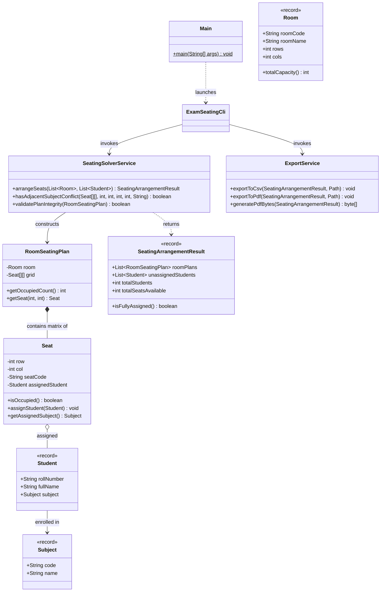

# 05 - Exam Seating Arrangement Optimization Engine

An intelligent constraint satisfaction algorithm (CSP) engine designed for university exam centers to allocate students into hall grid seats ensuring zero adjacent (horizontal/vertical) same-subject peers, with visual matrix rendering and automated CSV and PDF schedule export.

---

## 📸 Screenshots


---

## 🚀 Features
- **Constraint Satisfaction (CSP) Solver**: Formulates the exam seating matrix as a 2D grid constraint graph where orthogonal neighbors $(r \pm 1, c)$ and $(r, c \pm 1)$ are strictly forbidden from sharing the same academic subject code.
- **Largest-Degree-First Heuristic**: Interleaves cohorts by ordering subject queues by remaining student count, resolving the hardest constraints first to prevent terminal cohort deadlocks.
- **Multi-Room Capacity Balancing**: Dynamically balances cohorts across halls with custom rows and columns, handling room overflows and tracking unassigned overflow candidates.
- **Integrity Audit Engine**: Built-in verification routine (`validatePlanIntegrity`) that programmatically scans the generated 2D matrix to prove 0 clashes.
- **Multi-Format Export Engine**:
  - **Structured CSV Export**: Detailed tabular rosters with room, row, col, seat code, roll number, student name, and subject code.
  - **Visual OpenPDF Matrix**: Landscape A4 document featuring visual seating charts with color-coded subject badges and candidate rosters.

---

## 🛠️ Tech Stack
- **Language**: Java 17 (LTS)
- **Algorithms**: Constraint Satisfaction (CSP), Greedy Interleaving, FIFO Subject Queues, Grid Adjacency Matrix
- **Document Export**: OpenPDF (LibrePDF 1.3.43)
- **Data Formats**: CSV, PDF, Monospace ASCII
- **Testing**: JUnit 5, AssertJ
- **Build Tool**: Apache Maven

---

## 📋 Copy-Paste Run Commands

### 1. Run Automated Live Demonstration
Configures 2 halls (50 seats) and 45 students across CS101, MATH201, and PHY101, audits constraints, renders the ASCII matrix, and exports CSV & PDF files:
```bash
cd 05-exam-seating-arrangement
mvn clean compile exec:java -Dexec.args="--demo"
```

### 2. Run All Unit & Integration Tests
```bash
mvn test
```

### 3. Package & Run as Standalone Executable JAR
```bash
mvn clean package
java -jar target/05-exam-seating-arrangement-1.0.0.jar --demo
```

---

## 📂 Project Structure

```
05-exam-seating-arrangement/
├── pom.xml
├── README.md
└── src/
    ├── main/
    │   └── java/
    │       └── com/portfolio/examseating/
    │           ├── Main.java                          # CLI entry point
    │           ├── cli/
    │           │   └── ExamSeatingCli.java            # Interactive menu & ASCII grid viewer
    │           ├── model/
    │           │   ├── Room.java                      # Room dimensions & capacity record
    │           │   ├── RoomSeatingPlan.java           # 2D Seat[][] matrix container
    │           │   ├── Seat.java                      # Seat entity with student assignment
    │           │   ├── SeatingArrangementResult.java  # Aggregate results & unassigned lists
    │           │   ├── Student.java                   # Student record (rollNo, name, subject)
    │           │   └── Subject.java                   # Subject record (code, name)
    │           └── service/
    │               ├── ExportService.java             # CSV and OpenPDF exporter
    │               └── SeatingSolverService.java      # CSP solver with orthogonal conflict checks
    └── test/
        └── java/
            └── com/portfolio/examseating/service/
                ├── ExportServiceTest.java             # 2 tests for CSV and PDF magic header
                └── SeatingSolverServiceTest.java      # 5 tests for clashes, overflow, single subject
```

---

## 📊 Class Architecture Diagram



---

## 🔮 Future Improvements
- **Diagonal Conflict Mode**: Enable strict 8-way diagonal non-adjacency option for high-stakes standardized entrance examinations.
- **Bench / Desk Pairing**: Support 2-seater and 3-seater long benches with specific desk separation constraints.
- **Batch CSV Import**: Allow administrators to bulk-import student enrollments directly from institution Excel/CSV sheets.
