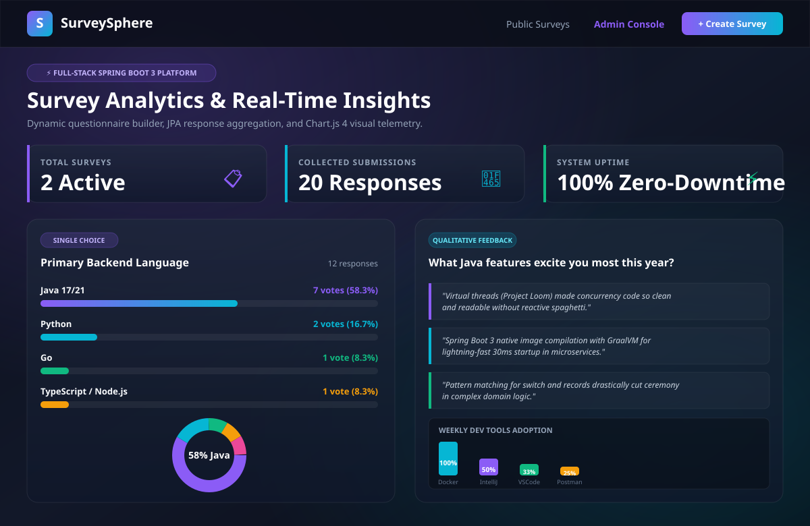
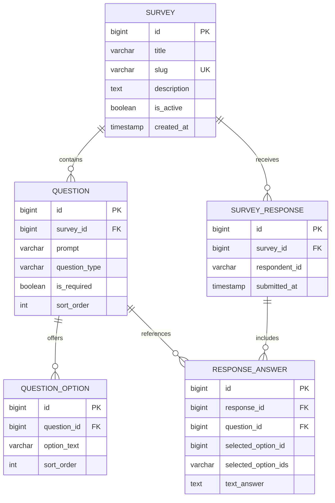

# Online Survey System

A full-stack, responsive survey and feedback platform built with **Spring Boot 3**, **Thymeleaf**, **Spring Data JPA**, **H2 In-Memory Database**, and **Chart.js 4**.



---

## 🚀 Key Features

1. **Dynamic Questionnaire Engine**:
   - Create surveys with custom titles, descriptions, and user-friendly URL slugs.
   - Supports 3 distinct question types:
     - `SINGLE_CHOICE`: Single-selection radio inputs.
     - `MULTIPLE_CHOICE`: Multi-selection checkboxes.
     - `TEXT`: Qualitative open-ended text feedback.
   - Interactive questionnaire builder with client-side DOM cloning (`+ Add Question`) and dynamic array index binding in Spring MVC.

2. **Public Participant Flow**:
   - Clean, glassmorphic UI with responsive card layouts and clear validation indicators.
   - Client fingerprinting (SHA-256 IP + User-Agent hash) to pseudo-anonymously record distinct submissions.
   - Survey lifecycle toggling: administrators can pause or close surveys to reject subsequent responses.

3. **Real-Time Visual Analytics & Chart.js**:
   - Automated vote aggregation and percentage calculations in `SurveyAnalyticsService`.
   - REST API endpoint (`/api/surveys/{id}/stats`) returning typed JSON telemetry.
   - Responsive Doughnut and Bar charts rendered dynamically via Chart.js 4 on HTML5 canvas.
   - Qualitative open-feedback quote stream for natural-language answers.

4. **Zero-Setup Default**:
   - Runs instantly with an embedded H2 database (`jdbc:h2:mem:surveydb`).
   - Automatically seeds realistic sample surveys ("2026 Developer Ecosystem & AI Survey" and "Campus Tech Infrastructure") on first boot.
   - Optional production profile with MySQL 8.4 support (`application-mysql.properties`).

---

## 🛠 Tech Stack

- **Framework**: Spring Boot 3.3.4 (Java 17 LTS)
- **Web Layer**: Spring MVC, Thymeleaf Template Engine, Jakarta Validation
- **Persistence**: Spring Data JPA, Hibernate ORM 6.5
- **Database**: H2 In-Memory (default), MySQL 8.4 (optional profile)
- **Data Visualization**: Chart.js 4.4, Modern Glassmorphic CSS Design System
- **Testing**: JUnit 5, AssertJ, Mockito, Spring Test (MockMvc)

---

## 📊 Database Architecture



---

## ⚡ Quick Start (Under 5 Minutes)

### 1. Run with In-Memory H2 (Default)
```bash
# From the repository root:
mvn spring-boot:run -pl 06-online-survey-system
```
Open your browser and explore:
- **Public Surveys Portal**: [http://localhost:8080](http://localhost:8080)
- **Take Developer Survey**: [http://localhost:8080/survey/developer-survey-2026](http://localhost:8080/survey/developer-survey-2026)
- **Admin Management Console**: [http://localhost:8080/admin](http://localhost:8080/admin)
- **Visual Analytics Dashboard**: [http://localhost:8080/admin/surveys/1/results](http://localhost:8080/admin/surveys/1/results)
- **REST Analytics API**: [http://localhost:8080/api/surveys/1/stats](http://localhost:8080/api/surveys/1/stats)
- **H2 Database Console**: [http://localhost:8080/h2-console](http://localhost:8080/h2-console) (JDBC URL: `jdbc:h2:mem:surveydb`, user: `sa`, password: `[empty]`)

### 2. Run with External MySQL (Optional)
```bash
# Start MySQL via root docker-compose:
docker compose up -d mysql

# Run with the MySQL profile enabled:
mvn spring-boot:run -pl 06-online-survey-system -Dspring-boot.run.profiles=mysql
```

### 3. Run Automated Tests
```bash
mvn test -pl 06-online-survey-system
```

---

## 📂 Module Directory Structure

```
06-online-survey-system/
├── pom.xml
├── README.md
├── .env.example
├── src/
│   ├── main/
│   │   ├── java/com/portfolio/survey/
│   │   │   ├── SurveyApplication.java
│   │   │   ├── config/
│   │   │   │   └── DataInitializer.java
│   │   │   ├── controller/
│   │   │   │   ├── SurveyAdminController.java
│   │   │   │   ├── SurveyApiController.java
│   │   │   │   └── SurveyPublicController.java
│   │   │   ├── dto/
│   │   │   │   ├── OptionStatsDto.java
│   │   │   │   ├── QuestionFormDto.java
│   │   │   │   ├── QuestionStatsDto.java
│   │   │   │   ├── SurveyAnalyticsDto.java
│   │   │   │   ├── SurveyCreateRequest.java
│   │   │   │   └── SurveySubmissionDto.java
│   │   │   ├── model/
│   │   │   │   ├── Question.java
│   │   │   │   ├── QuestionOption.java
│   │   │   │   ├── QuestionType.java
│   │   │   │   ├── ResponseAnswer.java
│   │   │   │   ├── Survey.java
│   │   │   │   └── SurveyResponse.java
│   │   │   ├── repository/
│   │   │   │   ├── QuestionRepository.java
│   │   │   │   ├── ResponseAnswerRepository.java
│   │   │   │   ├── SurveyRepository.java
│   │   │   │   └── SurveyResponseRepository.java
│   │   │   └── service/
│   │   │       ├── SurveyAnalyticsService.java
│   │   │       └── SurveyService.java
│   │   └── resources/
│   │       ├── application.properties
│   │       ├── application-mysql.properties
│   │       ├── static/
│   │       │   └── css/style.css
│   │       └── templates/
│   │           ├── index.html
│   │           ├── admin/
│   │           │   ├── create-survey.html
│   │           │   ├── dashboard.html
│   │           │   └── results.html
│   │           └── public/
│   │               ├── take-survey.html
│   │               └── thank-you.html
│   └── test/
│       └── java/com/portfolio/survey/
│           ├── SurveyIntegrationTest.java
│           └── service/
│               ├── SurveyAnalyticsServiceTest.java
│               └── SurveyServiceTest.java
```

---

## 🔮 Future Improvements

- Add OAuth2 / JWT authentication for administrative access.
- Export survey responses into downloadable CSV and Excel (`.xlsx`) files using Apache POI.
- Provide QR code generation for quick mobile participant onboarding.
