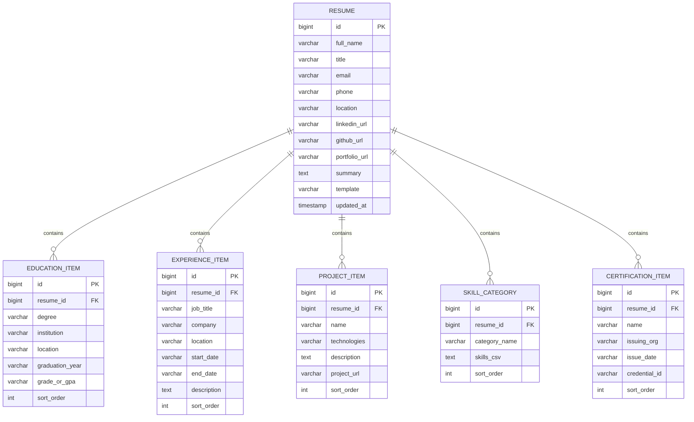

# Online Resume Builder with Live Preview & PDF Export

A professional full-stack resume builder built with **Spring Boot 3**, **Thymeleaf**, **Spring Data JPA**, **OpenPDF**, and **H2 In-Memory Database**. Create modern resumes, view an instant A4 paper preview with customizable design themes, and export print-ready PDFs with 1 click.


---

## 🚀 Key Features

1. **Interactive Multi-Section Resume Builder**:
   - Comprehensive contact details (Full Name, Title, Email, Phone, Location, Portfolio, LinkedIn, GitHub, Bio/Summary).
   - Structured sub-sections with dynamic row addition/removal:
     - **Education**: Degree, Institution, Location, Graduation Year, GPA/Grade.
     - **Experience**: Job Title, Company, Location, Date Range, Bullet Points.
     - **Projects**: Project Name, Technologies Used, Description, Live/GitHub URL.
     - **Skills Categorization**: Group skills into Technical, Frameworks, Tools, Soft Skills.
     - **Certifications**: Credential Name, Issuing Organization, Issue Date, Credential ID.

2. **Real-Time A4 Document Preview & Theme Switcher**:
   - Authentic 210mm × 297mm A4 layout preview directly in browser.
   - Dual aesthetic styles:
     - `MODERN`: Clean corporate typography, accent color headers, subtle dividers.
     - `MINIMALIST`: Monochromatic elegance, balanced whitespace, understated section lines.
   - Browser print styles (`@media print`) configured for clean physical printing.

3. **High-Fidelity Server-Side PDF Generation**:
   - Generates vector-sharp PDFs using **OpenPDF** (`com.github.librepdf:openpdf:1.3.43`), an open-source LGPL/MPL compliant PDF library.
   - Proper page margins, section header borders, bold titles, bullet list indentation, and hyperlink formatting.
   - Streamed directly via Spring MVC `ResponseEntity<byte[]>` with `Content-Disposition: attachment` headers.

4. **Zero-Setup Default & Persistence**:
   - Zero-installation default with an embedded H2 database (`jdbc:h2:mem:resumedb`).
   - Seeds a complete sample resume for "Alex Mercer - Senior Software Engineer" on initial startup.
   - RESTful API endpoints for JSON resume export (`/api/resumes/{id}`).

---

## 🛠 Tech Stack

- **Framework**: Spring Boot 3.3.4 (Java 17 LTS)
- **Web Layer**: Spring MVC, Thymeleaf Template Engine, Jakarta Validation
- **Persistence**: Spring Data JPA, Hibernate ORM 6.5
- **Database**: H2 In-Memory (default), MySQL 8.4 (optional profile)
- **Document Generation**: OpenPDF 1.3.43 (LibrePDF)
- **Styling**: Vanilla CSS3 (Custom A4 paper simulation, Glassmorphic Dashboard, CSS Grid/Flexbox)
- **Testing**: JUnit 5, AssertJ, Spring Test (MockMvc)

---

## 📊 Database Architecture



---

## ⚡ Quick Start (Under 5 Minutes)

### Prerequisites
- Java 17+ installed (`java -version`)
- Maven 3.8+ installed (`mvn -version`)

### Run the Application

```bash
# From the repository root or module directory
cd 07-online-resume-builder
mvn spring-boot:run
```

Once started, open your browser at:
- **Web Application**: [http://localhost:8080](http://localhost:8080)
- **Sample Resume Preview**: [http://localhost:8080/resumes/1](http://localhost:8080/resumes/1)
- **Download Sample PDF**: [http://localhost:8080/resumes/1/pdf](http://localhost:8080/resumes/1/pdf)
- **H2 Console**: [http://localhost:8080/h2-console](http://localhost:8080/h2-console) (JDBC URL: `jdbc:h2:mem:resumedb`, Username: `sa`, Password: *empty*)

---

## 🌐 Endpoints & Routes

| Method | Path | Description |
| :--- | :--- | :--- |
| `GET` | `/` | Portal landing page listing all saved resumes |
| `GET` | `/resumes/new` | Blank resume builder form |
| `POST` | `/resumes` | Save new or updated resume (redirects to preview) |
| `GET` | `/resumes/{id}` | Live A4 paper preview with template toggle |
| `GET` | `/resumes/{id}/edit` | Pre-populated editor form |
| `POST` | `/resumes/{id}/delete` | Delete resume |
| `GET` | `/resumes/{id}/pdf` | Download binary PDF (`application/pdf`) |
| `GET` | `/api/resumes/{id}` | REST API returning full resume JSON payload |

---

## 🧪 Testing

Run all unit and integration tests:

```bash
mvn test
```

### Test Coverage Highlights (11 Tests)
- `ResumeServiceTest`: Validates CRUD, sample seed creation, form DTO mapping, and entity cascading.
- `PdfResumeServiceTest`: Verifies OpenPDF document generation, non-null PDF byte stream output, and PDF magic bytes (`%PDF-1.`).
- `ResumeIntegrationTest`: Full Spring MVC test suite testing web controllers, HTTP status codes, PDF streaming headers, and JSON API payloads using `MockMvc`.
