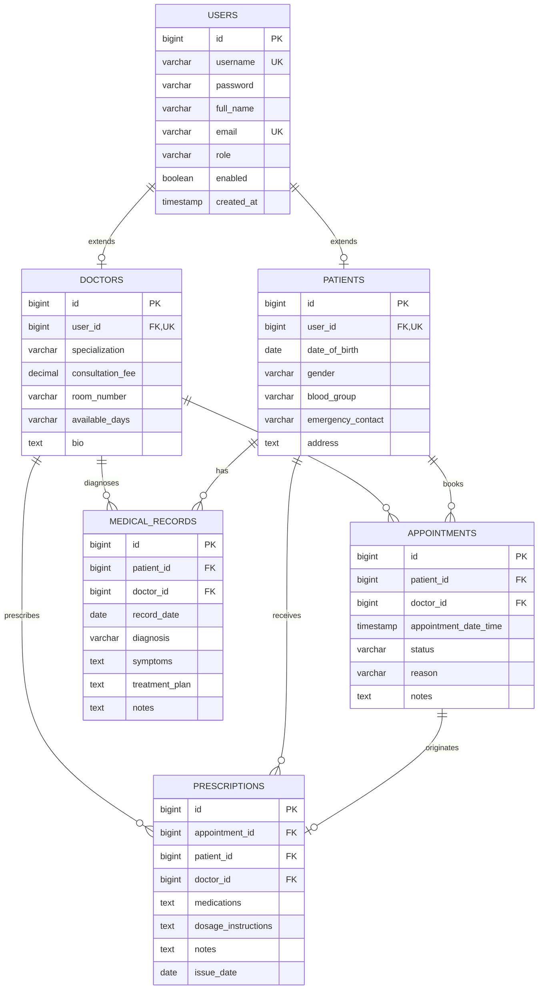
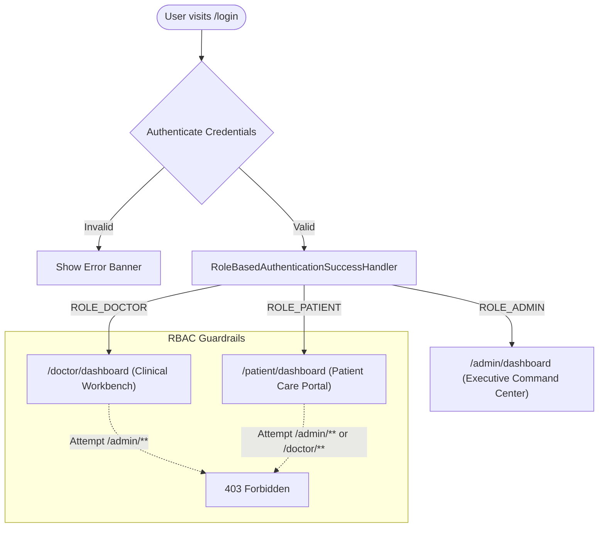

# Medical Management System with Role-Based Access Control (RBAC)

A comprehensive hospital and clinical operations platform built with **Spring Boot 3**, **Spring Security 6**, **Spring Data JPA**, **Thymeleaf**, and **H2 In-Memory Database**. Features role-based access control for 3 distinct user personas (**Admin**, **Doctor**, and **Patient**), automated appointment double-booking conflict resolution, digital prescriptions, and electronic medical records (EMR).


---

## 🚀 Key Features

1. **Spring Security 6 Role-Based Access Control (RBAC)**:
   - Dedicated authentication and authorization boundaries:
     - `ROLE_ADMIN`: Clinic oversight, staff onboarding, hospital-wide appointment auditing.
     - `ROLE_DOCTOR`: Clinical workbench, queue triage, consultation completion, Rx & EMR creation.
     - `ROLE_PATIENT`: Self-registration, doctor directory discovery, real-time consultation booking, prescription & EMR review.
   - Intelligent post-login routing via `RoleBasedAuthenticationSuccessHandler` directing users straight to their persona's dashboard.
   - Comprehensive test suite validating `403 Forbidden` barriers between roles with `@WithMockUser`.

2. **Double-Booking & Conflict-Free Scheduling**:
   - `AppointmentService` enforces database-level conflict checking:
     `existsByDoctorAndAppointmentDateTimeAndStatusNot(doctor, dateTime, CANCELLED)`
   - Rejects overlapping appointments with `AppointmentConflictException`.
   - Lifecycle state machine: `SCHEDULED` $\rightarrow$ `CONFIRMED` $\rightarrow$ `COMPLETED` or `CANCELLED`. Prevents illegal state transitions with `InvalidStatusTransitionException`.

3. **Electronic Medical Records (EMR) & Digital Rx**:
   - Doctors record clinical diagnoses, symptoms presentation, treatment regimens, and vital signs.
   - Integrated digital prescription generation detailing medications, dosage frequencies, and precautions.
   - Patients can view and print their full clinical history directly from their portal.

4. **Zero-Setup Default & 1-Click Demo Accounts**:
   - Runs out-of-the-box with embedded H2 database (`jdbc:h2:mem:medicaldb`).
   - Automatically pre-seeds realistic doctors (Dr. Gregory House, Dr. John Watson, Dr. Stephen Strange), patients, upcoming visits, and clinical records.
   - Pre-configured 1-click credential autofill buttons on `/login` for seamless recruiter demos.

---

## 🛠 Tech Stack

- **Framework**: Spring Boot 3.3.4 (Java 17 LTS)
- **Security**: Spring Security 6 (BCrypt Password Hashing, RBAC Filter Chains, Method Security)
- **Web Layer**: Spring MVC, Thymeleaf Template Engine, Jakarta Validation
- **Persistence**: Spring Data JPA, Hibernate ORM 6.5
- **Database**: H2 In-Memory (default), MySQL 8.4 (optional profile via `-Dspring-boot.run.profiles=mysql`)
- **Styling**: Vanilla CSS3 (Custom Glassmorphism, Responsive Grid, Medical Color Tokens)
- **Testing**: JUnit 5, AssertJ, Mockito, Spring Security Test (`@WithMockUser`), Spring Test (`MockMvc`)

---

## 📊 Architecture & Workflows

### 1. Database Entity-Relationship (ER) Diagram



### 2. Role-Based Access Control (RBAC) Flow



---

## ⚡ Quick Start (Under 5 Minutes)

### Prerequisites
- Java 17+ installed (`java -version`)
- Maven 3.8+ installed (`mvn -version`)

### Run the Application

```bash
# From repository root or module directory
cd 08-medical-management-system
mvn spring-boot:run
```

Once running, navigate to:
- **Landing Page**: [http://localhost:8080](http://localhost:8080)
- **Login Portal**: [http://localhost:8080/login](http://localhost:8080/login)
- **H2 Database Console**: [http://localhost:8080/h2-console](http://localhost:8080/h2-console) (JDBC URL: `jdbc:h2:mem:medicaldb`, User: `sa`, Password: *empty*)

### 🔑 Pre-Seeded Demo Accounts

| Role | Username | Password | Persona &amp; Responsibilities |
| :--- | :--- | :--- | :--- |
| **Admin** | `admin` | `admin123` | Clinic Director Sarah Chen (Hospital oversight, doctor onboarding) |
| **Doctor** | `dr_house` | `doctor123` | Dr. Gregory House (Diagnostic Medicine, Room 404) |
| **Doctor** | `dr_watson` | `doctor123` | Dr. John Watson (General Medicine, Room 101) |
| **Doctor** | `dr_strange` | `doctor123` | Dr. Stephen Strange (Neuro-Surgery, Suite 3) |
| **Patient** | `pat_john` | `patient123` | John Doe (Has scheduled appointments &amp; prescriptions) |
| **Patient** | `pat_sarah` | `patient123` | Sarah Connor (Confirmed appointment with Dr. Watson) |

---

## 🌐 Endpoints & Routes

| Method | Path | Required Role | Description |
| :--- | :--- | :---: | :--- |
| `GET` | `/` | *Public* | Home landing page, active specialist directory, role access cards |
| `GET` | `/login` | *Public* | Login card with 1-click demo credential autofill |
| `GET/POST`| `/register` | *Public* | Patient self-service registration form and submission |
| `GET` | `/admin/dashboard` | `ROLE_ADMIN` | Executive command center with KPI stats, doctor roster, and appointments |
| `GET/POST`| `/admin/doctors` | `ROLE_ADMIN` | Staff onboarding form and doctor account creation |
| `GET` | `/doctor/dashboard` | `ROLE_DOCTOR` | Clinical workbench showing daily queue and consultations |
| `POST` | `/doctor/appointments/{id}/status` | `ROLE_DOCTOR` | Transition appointment status (`CONFIRMED`, `COMPLETED`, `CANCELLED`) |
| `GET/POST`| `/doctor/prescriptions/new` | `ROLE_DOCTOR` | Issue digital prescription linked to patient and visit |
| `GET/POST`| `/doctor/records/new` | `ROLE_DOCTOR` | Create electronic diagnostic health record (EMR) |
| `GET` | `/patient/dashboard` | `ROLE_PATIENT` | Patient portal with upcoming visits and care history |
| `GET/POST`| `/patient/appointments/new` | `ROLE_PATIENT` | Conflict-checked consultation booking with doctor dropdown |
| `POST` | `/patient/appointments/{id}/cancel` | `ROLE_PATIENT` | Cancel visit with reason |
| `GET` | `/patient/prescriptions` | `ROLE_PATIENT` | View and print digital pharmacy prescriptions |
| `GET` | `/patient/records` | `ROLE_PATIENT` | View and print electronic medical records (EMR) |

---

## 🧪 Testing

Execute the comprehensive test suite:

```bash
mvn test -pl 08-medical-management-system
```

### Test Coverage Highlights (16 Tests)
- `MedicalSecurityIntegrationTest`: Enforces Spring Security 6 RBAC filter rules, public routes, unauthenticated redirects, and cross-role 403 authorization barriers using `@WithMockUser`.
- `AppointmentServiceTest`: Tests appointment scheduling, double-booking rejection with `AppointmentConflictException`, valid status transitions (`SCHEDULED` $\rightarrow$ `CONFIRMED` $\rightarrow$ `COMPLETED`), invalid transitions with `InvalidStatusTransitionException`, and cancellation notes.
- `MedicalRecordServiceTest`: Tests creation of diagnostic records, prescription issuance, and complete patient EMR retrieval.
- `MedicalRepositoryTest`: Validates `@DataJpaTest` slice, entity cascades, distinct specialty JPQL queries, and database-level slot conflict detection.
