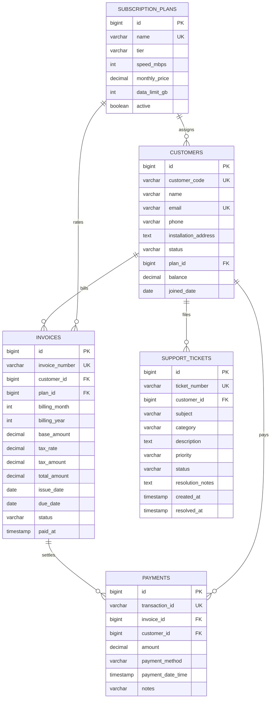
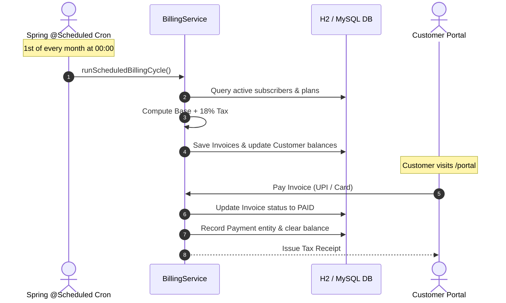

# ISP Automation & Broadband Operations Management System

A production-grade Internet Service Provider (ISP) billing and customer lifecycle platform built with **Spring Boot 3**, **Spring Data JPA**, **Thymeleaf**, and **H2 In-Memory Database**. Featuring automated recurring billing cron jobs (`@Scheduled`), dynamic fiber plan tier provisioning, self-service customer invoice settlement, and Network Operations Center (NOC) incident ticket dispatch.


---

## 🚀 Key Features

1. **Automated Recurring Billing Cron (`@Scheduled`)**:
   - `BillingSchedulerService` executes automated monthly invoice generation on the 1st of every month at midnight (`@Scheduled(cron = "${isp.billing.cron}")`).
   - Automatically calculates 18% regulatory GST/VAT tax on base plan tariffs.
   - Enforces unique billing cycle constraints (`uk_customer_billing_cycle`) to prevent duplicate billing for the same subscriber in a calendar cycle.
   - Nightly overdue cron flags unpaid invoices past their payment window as `OVERDUE`.
   - On-demand manual billing cycle trigger available in the NOC Operations Console.

2. **Broadband Plan Tiers & Subscriber Lifecycle**:
   - Multi-tier broadband catalog: `BASIC` (100 Mbps), `STANDARD` (300 Mbps), `ULTRA_FIBER` (1 Gbps), and `GIGABIT_ENTERPRISE` (2 Gbps dedicated SLA).
   - Dynamic FUP data tracking (Unlimited fiber vs. capped broadband).
   - Real-time customer balance ledger adjusting automatically upon bill generation and payment receipt.

3. **Customer Self-Service Care Portal**:
   - Live broadband speed and plan status dashboard.
   - Transparent itemized invoice breakdown with tax line items and printable receipts.
   - 1-Click instant payment simulation (UPI, Credit/Debit Card, Net Banking) immediately flipping invoices to `PAID` and clearing account balance.
   - Technical support ticket submission with category tags (Connectivity, Speed, Hardware, Billing).

4. **NOC Operations & Incident Dispatch**:
   - Real-time ISP health telemetry: Active Subscribers, Monthly Recurring Revenue (MRR), Total Settled Collections, Overdue Invoices, and Open Incidents.
   - Ticket lifecycle workflow state machine: `OPEN` $\rightarrow$ `IN_PROGRESS` $\rightarrow$ `RESOLVED` $\rightarrow$ `CLOSED`.
   - Field dispatch notes and resolution timestamp tracking.

5. **Zero-Setup Default**:
   - Runs instantly with embedded H2 database (`jdbc:h2:mem:ispdb`).
   - Pre-seeds realistic fiber subscribers, active plans, past paid invoices, unpaid bills, and NOC support tickets.
   - Optional MySQL 8.4 production profile support (`application-mysql.properties`).

---

## 🛠 Tech Stack

- **Framework**: Spring Boot 3.3.4 (Java 17 LTS)
- **Task Scheduling**: Spring Task Scheduling (`@EnableScheduling`, `@Scheduled`)
- **Web Layer**: Spring MVC, Thymeleaf Template Engine, Jakarta Validation
- **Persistence**: Spring Data JPA, Hibernate ORM 6.5
- **Database**: H2 In-Memory (default), MySQL 8.4 (optional profile)
- **Styling**: Vanilla CSS3 (Cyberpunk Glassmorphism, Network Speed Badges, Responsive Flex/Grid)
- **Testing**: JUnit 5, AssertJ, Mockito, Spring Test (`MockMvc`)

---

## 📊 Architecture & Workflows

### 1. Database Entity-Relationship (ER) Diagram



### 2. Automated Billing & Invoicing Lifecycle



---

## ⚡ Quick Start (Under 5 Minutes)

### Prerequisites
- Java 17+ installed (`java -version`)
- Maven 3.8+ installed (`mvn -version`)

### Run the Application

```bash
# From repository root or module directory
cd 09-isp-automation
mvn spring-boot:run
```

Once running, navigate to:
- **Public Showcase & Customer Switcher**: [http://localhost:8080](http://localhost:8080)
- **Subscriber Self-Service Portal**: [http://localhost:8080/portal?code=CUST-1001](http://localhost:8080/portal?code=CUST-1001)
- **NOC Operations Dashboard**: [http://localhost:8080/admin](http://localhost:8080/admin)
- **H2 Database Console**: [http://localhost:8080/h2-console](http://localhost:8080/h2-console) (JDBC URL: `jdbc:h2:mem:ispdb`, User: `sa`, Password: *empty*)

---

## 🌐 Endpoints & Routes

| Method | Path | Description |
| :--- | :--- | :--- |
| `GET` | `/` | Home portal, broadband plan catalog, and 1-click subscriber access |
| `GET` | `/portal` | Customer dashboard (active plan speed, balance, recent bills, tickets) |
| `GET` | `/portal/invoices` | List all billing invoices for the active subscriber |
| `GET` | `/portal/invoices/{id}` | Detailed printable invoice receipt with tax calculations |
| `POST`| `/portal/invoices/{id}/pay` | Process simulated instant online payment (UPI, Card, Net Banking) |
| `GET` | `/portal/tickets` | Support tickets history and NOC status timeline |
| `GET` | `/portal/tickets/new` | Open new support ticket form |
| `POST`| `/portal/tickets` | Submit support ticket to NOC |
| `GET` | `/admin` | NOC operations console: MRR metrics, subscribers, tickets backlog |
| `POST`| `/admin/billing/run` | Execute on-demand monthly billing run for all active subscribers |
| `POST`| `/admin/tickets/{id}/status`| Transition ticket status (`IN_PROGRESS`, `RESOLVED`, `CLOSED`) |

---

## 🧪 Testing

Execute the comprehensive test suite:

```bash
mvn test -pl 09-isp-automation
```

### Test Coverage Highlights (17 Tests)
- `BillingServiceTest`: Validates 18% tax calculation, customer balance adjustment, duplicate billing cycle rejection (`DuplicateInvoiceException`), payment recording, status flip to `PAID`, and overdue batch tagging.
- `TicketServiceTest`: Validates ticket opening with unique ticket numbers, status state transitions (`OPEN` $\rightarrow$ `IN_PROGRESS` $\rightarrow$ `RESOLVED`), and illegal transition rejection from `CLOSED` status.
- `IspRepositoryTest`: Validates `@DataJpaTest` slice, active plans ordering, total revenue summation query, and overdue invoice retrieval.
- `IspIntegrationTest`: Full Spring MVC integration test suite validating web routing, online invoice payment flows, ticket submissions, and admin billing cycle triggers via `MockMvc`.
