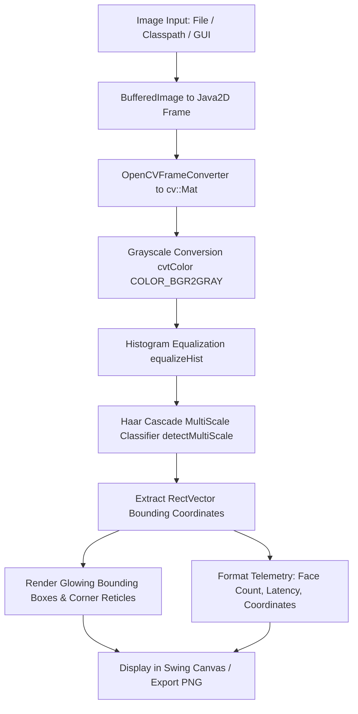

# 👁️ Project 10: Computer Vision Face Detection System

[](https://openjdk.org/)
[](https://opencv.org/)
[](https://github.com/bytedeco/javacv)
[](https://docs.oracle.com/en/java/javase/17/docs/api/java.desktop/javax/swing/package-summary.html)
[](https://github.com/pabitra/java-projects)
[](https://junit.org/junit5/)

An edge-native, real-time Computer Vision application written in Java that performs multi-scale human face detection using **JavaCV 1.5.10** bindings and the official **OpenCV 4.9.0 Haar Feature-based Cascade Classifier**. Features a modern dark-mode Swing desktop GUI, automated CLI batch runner, and a foundational **Ethical AI & Privacy Framework** guaranteeing local edge computation and zero biometric data retention.

---

## 📸 Application Preview

<p align="center">
  
</p>

---

## ⚖️ Ethical AI & Privacy Disclosure

> [!IMPORTANT]
> **Privacy-First Architecture:** This project complies strictly with ethical AI, edge computing, and data protection standards:
>
> 1. **100% Local Edge Processing**: All image transformations and inference occur entirely in local memory (RAM). Zero image files or facial coordinates are uploaded, shared, or transmitted across networks.
> 2. **Face Detection vs. Facial Recognition**: This software detects the *geometric coordinates* where a human face is located. It **does NOT** perform facial recognition, identity profiling, demographic inference, or biometric template generation.
> 3. **Zero Data Persistence**: Bounding box coordinates exist only in volatile heap memory during execution. No biometric database or logs are created.
> 4. **Education & Accessibility**: Designed purely for educational, interface navigation, and accessibility prototyping.

---

## 🏗️ System Architecture & Vision Pipeline

The application processes raw images through a deterministic multi-stage computer vision pipeline:



---

## ✨ Key Features

1. **Native OpenCV Haar Cascades**:
   - Packaged with the official, pre-trained `haarcascade_frontalface_default.xml` model for 100% offline, zero-dependency execution.
   - Dynamic extraction to sandboxed temporary caches ensuring seamless multi-platform compatibility across **macOS (Apple Silicon M-series & Intel)**, **Linux (x86_64 & aarch64)**, and **Windows**.

2. **Image Preprocessing & Equalization**:
   - Automated conversion to 8-bit single-channel grayscale.
   - Histogram equalization (`equalizeHist`) normalizes lighting imbalances, harsh shadows, and extreme exposure before feature extraction.

3. **Modern Dark-Mode Swing GUI**:
   - Built with a Slate-900 / Indigo / Emerald color palette.
   - Dynamic image canvas with bilinear interpolation and automatic aspect-ratio scaling.
   - Live telemetry card displaying inference latency (ms), resolution, and bounding coordinates.
   - Interactive slider controls allowing real-time tuning of detection parameters.

4. **Dual Execution Modes (GUI + Headless CLI)**:
   - **Interactive Desktop App**: Full-featured graphical studio with file chooser and image export.
   - **Automated CLI Runner**: Headless batch execution (`--cli --image <path> --output <result.png>`), perfect for continuous integration pipelines and server scripts.

---

## 🛠️ Technology Stack

| Layer | Technology | Version | Purpose |
| :--- | :--- | :--- | :--- |
| **Language** | Java (OpenJDK) | 17 LTS | Modern Records, Pattern Matching, Clean Core Java |
| **CV Engine** | OpenCV Platform | 4.9.0 | Haar Cascade Classifiers, Image Filtering, Feature Detection |
| **Java Bindings** | JavaCV / JavaCPP | 1.5.10 | Zero-overhead native bridging between JVM and OpenCV C++ |
| **UI Framework** | Java Swing / Java2D | Java 17 Built-in | Desktop GUI, Custom Image Canvas, Antialiased Rendering |
| **Testing** | JUnit 5 & AssertJ | 5.11.4 / 3.27.3 | Unit & integration tests for CV pipeline & geometry |
| **Build Tool** | Apache Maven | 3.10.x | Multi-module dependency management & cross-platform packaging |

---

## 🚀 How to Run (Sub-5-Minute Clone-and-Run)

### Prerequisites
- Java 17 LTS installed (`java -version`)
- Maven 3.8+ installed (`mvn -v`)

### Option 1: Interactive Swing GUI (Default)
```bash
# From the repository root:
mvn exec:java -pl 10-face-detection
```

### Option 2: Run Bundled Sample Image in CLI (Headless Compatible)
```bash
mvn exec:java -pl 10-face-detection -Dexec.args="--sample"
```

### Option 3: Headless CLI Batch Mode with Image Export
```bash
mvn exec:java -pl 10-face-detection -Dexec.args="--cli --image path/to/photo.jpg --output target/detected_faces.png"
```

### Option 4: View Ethical AI Disclosure in Console
```bash
mvn exec:java -pl 10-face-detection -Dexec.args="--ethics"
```

---

## 🎛️ Tuning Parameters Guide

| Parameter | Default | Range | Description |
| :--- | :---: | :---: | :--- |
| **Scale Factor** | `1.10x` | 1.05 - 1.50 | Controls scale step size during multi-scale pyramid search. Smaller values (1.05) detect more faces but increase latency; larger values (1.20+) accelerate inference. |
| **Min Neighbors** | `4` | 1 - 10 | Specifies candidate neighbor rectangles required to retain a detection. Higher values eliminate false positives; lower values detect fainter faces. |
| **Min Size** | `30px` | 15 - 100px | Minimum bounding box dimension. Filters out small artifacts and noise. |

---

## 🧪 Automated Test Suite

Run the unit and integration tests:
```bash
mvn test -pl 10-face-detection
```

### Test Coverage Highlights:
- `shouldInitializeClassifierSuccessfully`: Verifies native OpenCV cascade classifier loads without errors from extracted resources.
- `shouldDetectFaceOnSampleImage`: Verifies detection of frontal human faces on test portraits with accurate coordinate boundaries.
- `shouldHandleImageWithNoFacesGracefully`: Confirms robust 0-face edge-case handling on blank/featureless images without exceptions.
- `shouldRejectInvalidParameters`: Validates bounds checking on scale factors, neighbor thresholds, and null image inputs.
- `shouldSupportDetectedFaceCalculations`: Validates geometric helper functions (`toRectangle()`, `getArea()`, center coordinates).
- `shouldVerifyEthicsDisclaimerPrinciples`: Asserts the presence of mandatory ethical AI, non-retention, and edge-processing guarantees.

---

## 🎓 Key Learnings for Technical Interviews

- **Bridging JVM and Native C++**: Learned how JavaCV and JavaCPP map off-heap native memory structures (`cv::Mat`, `cv::RectVector`) to Java objects using high-performance JNI wrappers without garbage collection overhead.
- **Histogram Equalization**: Understood why nonlinear contrast adjustment (`equalizeHist`) is vital for computer vision feature extraction under non-uniform illumination.
- **Computer Vision Pipeline Optimization**: Mastered the distinction between image preprocessing, classifier pyramid scaling, and Java2D post-processing annotation rendering.
- **Responsible AI Engineering**: Gained practical experience designing privacy-compliant software architectures that intentionally decouple transient detection from biometric identification.
