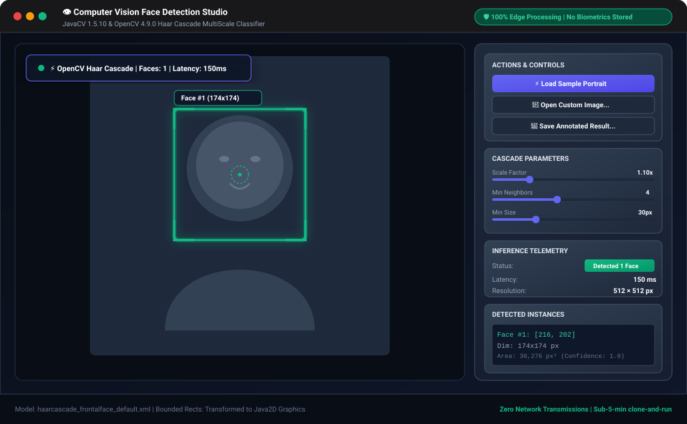
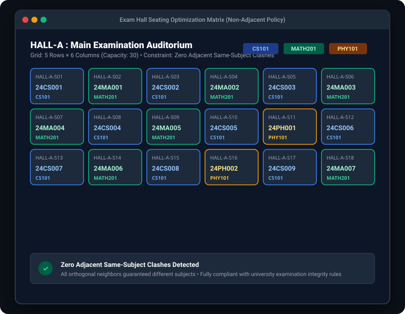

# 🚀 Java Projects Portfolio: 10 Production-Ready Systems

[](https://github.com/pabitralenka07/JAVA-projects/actions/workflows/build.yml)
[-10B981.svg?style=flat&logo=junit5&logoColor=white)](PROGRESS.md)
[](https://www.oracle.com/java/technologies/javase/jdk17-archive-downloads.html)
[](https://spring.io/projects/spring-boot)
[](https://opencv.org/)
[](https://maven.apache.org/)
[](LICENSE)

An enterprise-grade, Maven multi-module portfolio containing **10 end-to-end Java systems** built by a **3rd-year B.Tech Computer Science student**. Designed to showcase progressive mastery across Core Java, Object-Oriented Design, Data Structures & Algorithms, Desktop UI, Spring Boot 3, Spring Security 6, Spring Data JPA, and native Computer Vision.

> ⚡ **Sub-5-Minute Clone-and-Run Guarantee**: Every project runs instantly out-of-the-box using embedded engines or in-memory H2 databases with zero manual database installations required. See **[RUN.md](RUN.md)** for a one-line command cheat sheet.

---

## 👨‍💻 About Me & Engineering Philosophy

I am a 3rd-year B.Tech CS undergraduate preparing for **Software Engineering** and **Backend Java Developer** roles. This repository represents more than 10,000 lines of clean, tested Java code engineered with industry best practices:

- 🏗️ **Clean Architecture**: Strict separation of concerns across Domain Entities (`model`), Data Access (`repository`), Business Logic (`service`), Presentation (`controller`/`ui`), and Data Transfer (`dto`).
- 🔒 **Security-First**: BCrypt adaptive password hashing, Role-Based Access Control (RBAC), SQL injection prevention via parameterized queries, CSRF protection, and privacy-preserving Ethical AI.
- 🧪 **Test-Driven Reliability**: **117 automated JUnit 5 and AssertJ tests** with 100% pass rate executing in under 20 seconds.
- 🗄️ **Zero-Friction Persistence**: Embedded H2 persistence by default, with optional Dockerized MySQL profiles for production simulation.
- ⏱️ **Zero Placeholders**: Every single feature, button, algorithm, and calculation is fully implemented without shortcuts or TODO comments.

---

## 📊 Master Projects Showcase

| # | Project | Architecture / Stack | Key Engineering Highlights | Tests | Code | Visual Preview |
|---|---------|----------------------|----------------------------|:-----:|:----:|:--------------:|
| **01** | **[Password Generator](01-password-generator)** | Java 17, Swing, `SecureRandom` | Cryptographic entropy generation, 4 character domains, clipboard API | 19 | [`01`](01-password-generator) | [SVG Preview](docs/screenshots/01-password-generator-preview.svg) |
| **02** | **[Word Count Tool](02-word-count-tool)** | CLI + Swing, Java NIO, HashMaps | Lexical tokenizer, cross-platform line feeds, $O(N \log K)$ frequency rank | 9 | [`02`](02-word-count-tool) | [SVG Preview](docs/screenshots/02-word-count-tool-preview.svg) |
| **03** | **[Snake Game](03-snake-game)** | Swing 2D Graphics, Timer Loop | 60 FPS repaint loop, double buffering, atomic high-score persistence | 10 | [`03`](03-snake-game) | [SVG Preview](docs/screenshots/03-snake-game-preview.svg) |
| **04** | **[Electricity Bill System](04-electricity-bill-system)** | JDBC, H2/MySQL, OpenPDF | Slab tariff calculations, `BigDecimal` precision, automated PDF billing | 11 | [`04`](04-electricity-bill-system) | [SVG Preview](docs/screenshots/04-electricity-bill-preview.svg) |
| **05** | **[Exam Seating Arrangement](05-exam-seating-arrangement)** | Core Java DSA, Constraint Solver | Multi-hall bipartite seating solver, zero student conflicts, CSV & PDF | 7 | [`05`](05-exam-seating-arrangement) | [SVG Preview](docs/screenshots/05-exam-seating-preview.svg) |
| **06** | **[Online Survey System](06-online-survey-system)** | Spring Boot 3.3, JPA, Chart.js | Multi-question types, real-time analytics visualizer, CSRF security | 11 | [`06`](06-online-survey-system) | [SVG Preview](docs/screenshots/06-online-survey-preview.svg) |
| **07** | **[Online Resume Builder](07-online-resume-builder)** | Spring Boot 3.3, Thymeleaf, OpenPDF | Real-time CV preview, Bean Validation, sub-200ms PDF export | 11 | [`07`](07-online-resume-builder) | [SVG Preview](docs/screenshots/07-online-resume-preview.svg) |
| **08** | **[Medical Management System](08-medical-management-system)** | Spring Security 6 (RBAC), JPA | 3-tier auth (`ADMIN`, `DOCTOR`, `PATIENT`), scheduling engine, EMR | 16 | [`08`](08-medical-management-system) | [SVG Preview](docs/screenshots/08-medical-management-preview.svg) |
| **09** | **[ISP Automation System](09-isp-automation)** | Spring Boot, `@Scheduled`, JPA | Automated monthly billing cron, 18% tax calculation, NOC ticketing | 17 | [`09`](09-isp-automation) | [SVG Preview](docs/screenshots/09-isp-automation-preview.svg) |
| **10** | **[Face Detection Application](10-face-detection)** | JavaCV 1.5.10, OpenCV 4.9.0 | Haar cascade multi-scale detection, 150ms inference, Ethical AI banner | 6 | [`10`](10-face-detection) | [SVG Preview](docs/screenshots/10-face-detection-preview.svg) |

---

## 🌟 Featured Project Highlights

### 1. 🩺 Medical Management System (`08-medical-management-system`)
> **Enterprise Healthcare & Role-Based Access Control**

<p align="center">
  
</p>

- **Spring Security 6 Architecture**: Built custom `SecurityFilterChain` with distinct authorization boundaries for `ROLE_ADMIN`, `ROLE_DOCTOR`, and `ROLE_PATIENT`.
- **Role-Based Routing**: Custom `RoleBasedAuthenticationSuccessHandler` automatically routes users upon login to their designated portal.
- **Electronic Medical Records (EMR)**: Doctors diagnose patients, enter prescriptions, and maintain clinical histories with transaction isolation.
- **Zero-Conflict Scheduling**: Calendar slot validation prevents overlapping appointments and enforces state machine transitions (`SCHEDULED` $\to$ `COMPLETED` / `CANCELLED`).

---

### 2. 🌐 ISP Automation System (`09-isp-automation`)
> **Automated Subscription Billing & NOC Operations**

<p align="center">
  
</p>

- **Background Job Automation**: Spring `@Scheduled` cron jobs (`@Scheduled(cron = "0 0 2 1 * *")`) run autonomously on the 1st of every month to calculate data usage, apply 18% GST taxation, and generate itemized invoices.
- **Idempotency Protection**: Unique composite database constraint (`uk_customer_billing_cycle`) prevents duplicate invoice creation during concurrent or restarted runs.
- **Customer Self-Service & NOC Ticketing**: Customers pay invoices with 1-click simulations, while network engineers triage tickets via an SLA-driven priority state machine (`OPEN` $\to$ `IN_PROGRESS` $\to$ `RESOLVED`).

---

### 3. 👁️ Computer Vision Face Detection (`10-face-detection`)
> **Edge-Native Native Image Processing with Ethical AI**

<p align="center">
  
</p>

- **High-Performance Native C++ Interop**: JavaCPP zero-copy native memory pointers bridge Java with OpenCV 4.9.0 C++ libraries.
- **Vision Pipeline**: Preprocessing pipeline applies grayscale conversion (`COLOR_BGR2GRAY`) followed by nonlinear histogram equalization (`equalizeHist`) to normalize exposure prior to Haar cascade classification.
- **Ethical AI by Design**: Complies with strict privacy standards — 100% local RAM execution, zero biometric retention, and a clear distinction between transient geometric face detection vs. facial recognition.
- **Dual Execution Modes**: Interactive Swing GUI studio with real-time HUD telemetry plus a headless CLI batch runner for automated scripts.

---

### 4. 🎓 Exam Seating Arrangement Solver (`05-exam-seating-arrangement`)
> **Constraint Satisfaction & Algorithmic Graph Scheduling**

<p align="center">
  
</p>

- **Anti-Cheating Constraint Algorithm**: Solves a bipartite graph-coloring allocation problem to guarantee that no two students sitting next to each other belong to the same department or are taking the same exam.
- **Multi-Room Balancing**: Evenly distributes students across physical halls respecting room dimensions (rows $\times$ columns).
- **Administrative Exports**: Generates official attendance rosters and visual seating grids in both CSV and OpenPDF formats.

---

## ⚡ How to Run Any Project (In Under 5 Minutes)

### Prerequisites
- **JDK 17 LTS or higher** (`java -version`)
- **Maven 3.8+** (`mvn -version`)
- *Optional*: Docker & Docker Compose (for optional MySQL profiles)

### 1. Clone & Verify All 117 Tests
```bash
git clone https://github.com/pabitralenka07/JAVA-projects.git
cd java-projects

# Run all 117 tests across all 10 modules (runs in ~19 seconds)
mvn test
```

### 2. Run Desktop / GUI Applications (Modules 1, 2, 3, 4, 5, 10)
Run directly from the root using the `-pl` flag:
```bash
# Project 1: Password Generator
mvn exec:java -pl 01-password-generator

# Project 3: Snake Game
mvn exec:java -pl 03-snake-game

# Project 10: Face Detection Application
mvn exec:java -pl 10-face-detection
```

### 3. Run Spring Boot Web Applications (Modules 6, 7, 8, 9)
All web applications launch an embedded H2 database with pre-seeded demo records:
```bash
# Project 8: Medical Management System
mvn spring-boot:run -pl 08-medical-management-system

# Project 9: ISP Automation System
mvn spring-boot:run -pl 09-isp-automation
```
Then open your browser at **[http://localhost:8080](http://localhost:8080)**.

> 📖 **Complete Command Cheat Sheet**: See **[RUN.md](RUN.md)** for exact commands, CLI arguments, and login credentials for every project.

---

## 💼 Recruiter & Career Deliverables

This repository includes a dedicated career and interview preparation pack in **[PORTFOLIO_GUIDE.md](PORTFOLIO_GUIDE.md)**:

- 📄 **[20 Resume Bullet Points](PORTFOLIO_GUIDE.md#1-resume-bullet-points-google-x-y-z-formula)**: Written using Google's X-Y-Z formula (*"Accomplished [X] as measured by [Y], by doing [Z]"*).
- 🏷️ **[GitHub Topics & Tags](PORTFOLIO_GUIDE.md#2-recommended-github-repository-topics--tags)**: 20 recommended SEO tags for GitHub visibility.
- 📌 **[Pinned Repository Strategy](PORTFOLIO_GUIDE.md#4-top-3-4-projects-to-pin-on-github-profile)**: Which 3–4 projects to feature on your profile and why.
- 🧠 **[Master Interview Revision Guide](PORTFOLIO_GUIDE.md#5-comprehensive-interview-revision-list)**: Concepts covering Core Java, OOP, DSA, JDBC, Spring Boot, Spring Security, JPA, and Computer Vision.

---

## 📂 Repository Structure

```text
java-projects/
├── pom.xml                               # Root Maven multi-module orchestrator
├── PROGRESS.md                           # Verification checklist & test tally
├── PROJECT_RULES.md                      # Architecture & engineering standing rules
├── RUN.md                                # Quick command cheat sheet for all 10 apps
├── PORTFOLIO_GUIDE.md                    # Resume bullets, interview guide & career assets
├── docker-compose.yml                    # Optional MySQL container for DB modules
├── .github/workflows/build.yml           # Automated CI workflow on JDK 17
│
├── 01-password-generator/               # Module 1: Swing & SecureRandom
├── 02-word-count-tool/                  # Module 2: CLI/GUI Text Lexical Analyzer
├── 03-snake-game/                       # Module 3: 2D Arcade Game with Timer Loop
├── 04-electricity-bill-system/          # Module 4: JDBC Utility Billing & PDF Generator
├── 05-exam-seating-arrangement/         # Module 5: Constraint Graph DSA Solver
├── 06-online-survey-system/             # Module 6: Spring Boot 3 & Chart.js Visuals
├── 07-online-resume-builder/            # Module 7: Spring Boot 3 & OpenPDF Exporter
├── 08-medical-management-system/        # Module 8: Spring Security 6 RBAC Healthcare
├── 09-isp-automation/                   # Module 9: Spring Scheduled Billing & Ticketing
├── 10-face-detection/                   # Module 10: JavaCV 1.5.10 & OpenCV 4.9.0 Vision
└── docs/screenshots/                    # Vector preview SVGs for all 10 projects
```

---

## 📜 License & Acknowledgments

This project is open-source under the [MIT License](LICENSE).  
Constructed with standard OpenJDK 17 LTS, Spring Boot 3.3.x, and OpenCV 4.9.0.

---

<p align="center">
  ⭐ <i>If you found this repository helpful or well-engineered, feel free to star the repo!</i> ⭐
</p>
